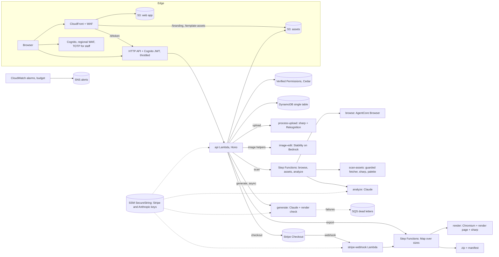

# AdStudio architecture

AdStudio is a white-labelled web app where an agency's clients produce ready-to-upload ads in 8 sizes (5 display, 3 Meta), either from a locked template or from their website. One deployment serves one agency, entirely inside the agency's own AWS account. This document describes the system as built; [README.md](README.md) covers setup and the API, [RUNBOOK.md](RUNBOOK.md) day-to-day operations, and [docs/adr](docs/adr) the main decisions.

## Principles

- **One renderer.** The editor preview, the template builder and the exported file all come from the same template JSON, the same text-fitting code (`shared/`) and the same React/Konva scene (`client/src/renderer`), with the same font files. The server renders exports in headless Chromium, so the layout clients see is the layout they download.
- **AI fills templates; it does not draw ads.** Claude picks templates, writes copy within each slot's limits and chooses photos and colours; the template does the design.
- **Never invent facts.** Offers come only from the website (with a verbatim quote that code checks against the page) or from the client. Anything else is `[confirm]`, which blocks export.
- **Permissions are data.** Roles are records with permission checklists; saving one rewrites its Cedar policies in Amazon Verified Permissions. No deploy needed.
- **Near-zero idle cost.** Serverless only: Lambda, Step Functions, one on-demand DynamoDB table, S3, CloudFront. No VPC, NAT gateway or database server.

## Components

Everything is one CDK stack (`AdStudioStack`) built from constructs in `infra/lib`: `storage`, `auth`, `edge` (WAF), `web` (CloudFront, HTTP API, api and webhook Lambdas), `media` (the container image shared by render, process-upload, scan-assets and image-edit), `export-pipeline`, `scan-pipeline`, `ai` and `monitoring`.

| Folder | Contents |
| --- | --- |
| `shared/` | Template types, sizes, validation, lint, text fitting, crop, contrast, seed templates. No dependencies; used by the backend, the client and the render page. |
| `backend/` | API (Hono), data access, authorization, Lambda handlers, scripts and tests. |
| `client/` | React app (client and admin areas) plus `render.html`, the page the render Lambda loads. |
| `media/` | Dockerfile and dependencies for the container Lambdas (Chromium, sharp). |
| `infra/` | CDK app and template tests. |

## Main flows

1. **Template ad.** A client opens an ad set (a project pinned to a template version), edits slot values once for all sizes with per-size overrides where needed, and watches all 8 sizes render live. Overflow, `[confirm]`, missing values and 9:16 safe-zone problems block export.
2. **Website ad.** A client confirms they own a URL; the scan state machine browses it with AgentCore Browser, downloads images through the guarded fetcher, ranks logos, builds a palette, and asks Claude to pick the logo, label photos and extract services, offers (with quotes) and CTAs. The client reviews and saves a brand kit, then **Generate** picks 3 templates, writes copy, assigns images and colours, checks fit with real fonts and checks claims, and returns 3 variants to edit.
3. **Export.** The API re-checks permissions and content and, for paying clients, returns a Stripe Checkout URL; the signed webhook (or an exempt client) starts the export state machine, which renders each size in Chromium, compresses (display sizes to 150 KB or less), zips with a manifest and marks the export ready. Downloads use presigned URLs; emailed links go through `/d/<token>`, which re-checks payment and refunds.

## Data

One DynamoDB table (`adstudio`, on demand, `PK`/`SK`, `GSI1PK`/`GSI1SK`, TTL on `expiresAt`); the full key table is in the README. Large documents live in the assets bucket with a pointer in the item: template drafts and versions (`templates/`), export snapshots and files (`exports/`), scan captures and results (`scans/`). Client files are private; only `branding/`, `template-assets/` and `scan-fixtures/` are served through CloudFront.

## Security

- Invite-only Cognito, SRP sign-in, 15-minute access tokens, TOTP required for staff (configurable in Settings), regional WAF on sign-in.
- Every API request passes the Cognito JWT authorizer and a Cedar check in code; lists are filtered with `BatchIsAuthorized`; another client's resources return 404.
- Uploads are re-encoded by sharp (EXIF stripped); website images come through the guarded fetcher (public addresses only, checked on every redirect hop, size and time limits, content sniffing); SVG logos from websites are sanitised before rasterising.
- Website text reaches Claude only as quoted data in tool-less, schema-constrained calls; every offer must quote the page and is checked in code.
- Stripe Checkout is hosted; webhooks are signature-checked and de-duplicated; amounts come from the server's price catalogue.
- Secrets are SSM SecureString parameters readable only by the Lambdas that need them. IAM names exact Bedrock models, S3 prefixes and the Verified Permissions store.
- CloudFront has AWS WAF (IP reputation, common rules, bad inputs, rate limits on `/d/*` and overall); the HTTP API is throttled.

## Differences from the original plan

| Plan | As built | Why |
| --- | --- | --- |
| pnpm workspaces, 7 stacks | npm folders, one stack of constructs | Follows the agency's existing projects; one stack deploys and tears down in one step |
| Claude Haiku 5.5 and Sonnet 5.5 on Bedrock | Provider switch: Bedrock 5.x, Bedrock 4.x (Haiku 4.5, Sonnet 4.6) or the Claude API | The AWS account had no access to Claude 5.x on Bedrock; see ADR 0006 |
| Stable Image Core for backgrounds | Stability Style Guide with a brand-colour swatch, gradient fallback | No text-to-image Stability model is offered in the account's Bedrock catalogue |
| WAF rate limits on `/scans` | Daily per-client limits in Settings plus API Gateway throttling | WAF cannot be attached to an HTTP API |
| Export Map concurrency 8 | Configurable, 4 by default | The account's Lambda concurrency limit is 10 until raised |
| Golden test with a 0.5% pixel limit | Exact layout match (font sizes and line breaks) plus a 3% pixel limit | macOS and Linux rasterise glyph edges differently; layout is what must match |
| SVG uploads | Raster uploads only; SVG accepted from website scans after sanitising | Keeps the upload path simple; scans need SVG logos |
